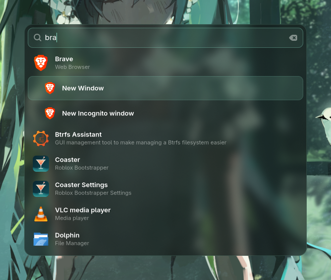

<div align="center">


# pixie

**A small, fast app launcher for Wayland.**

Fuzzy search that learns what you use, desktop actions, a quick calculator
and a frosted popup that is on screen about 70 ms after you press the key,
written in Rust. A sibling of [wisp](https://github.com/athenameow/wisp).



</div>

## Features

- **Fuzzy search.** Matches app names, generic names, keywords and the executable, so `bra`, `web browser` and `brave` all find Brave.
- **Learns your habits.** Ranking blends match quality with how often and how recently you launched each app. With nothing typed, your most-used apps come first.
- **Desktop actions.** <kbd>Tab</kbd> or <kbd>→</kbd> on an app shows its actions, like Brave's *New Incognito window* or Firefox's *New Private Window*.
- **Calculator.** Start with `=` and the answer appears as you type: `=12*4.5`, `=100%10`, `=sqrt(2)`. <kbd>Enter</kbd> copies it. See [Calculator](#calculator).
- **Run commands.** Type `>` and a shell command. <kbd>Enter</kbd> runs it, <kbd>Ctrl</kbd>+<kbd>Enter</kbd> runs it in a terminal that stays open.
- **Plays well with UWSM.** Under UWSM, apps start through `uwsm app`, each in its own systemd scope. Launched apps never belong to pixie.
- **Transparent and blurred.** The popup is a translucent card. On compositors that support it, the background behind it is blurred.
- **Nothing in the background.** No daemon. The popup only runs while it's open.

## How it works

| | What it does | Cost |
| --- | --- | --- |
| `pixie` | A tiny starter (no GTK) that runs `pixie-ui`. It exists to clear `__GLX_VENDOR_LIBRARY_NAME`, which otherwise makes every GTK app load the NVIDIA GL driver at startup, ~17 ms for nothing. Launched apps get the variable back. | under 1 ms |
| `pixie-ui` | The GTK4 popup, shown as a `wlr-layer-shell` overlay. Reads the app list through GIO on a second thread while GTK starts. Running `pixie` again while it's open closes it, so one keybind toggles it. | ~72 ms from keypress to the first frame, ~75 MB RSS (40 MB PSS) only while open |

There is no daemon: reading ~80 desktop entries through GIO takes about 6 ms and
overlaps GTK's own startup, so a cache would save nothing.

Typing re-ranks every app on each keystroke (about 0.05 ms for 300 apps) and shows the
best 40. Launch history lives in `~/.local/share/pixie/history.toml`.

Measured on CachyOS, Hyprland 0.57, GTK 4.24, RTX 4070, 1080p:

| | |
| --- | --- |
| Keypress to first frame | 71–74 ms |
| Keystroke to updated results (320 apps) | 0.4–2.8 ms, plus 0.2–1.3 ms to draw |
| Memory while open | 75 MB RSS, 40 MB PSS |
| Memory and CPU while closed | none (the process exits) |

To time it on your machine, run `PIXIE_TIMING=1 pixie` from a terminal. It prints how
long each startup step took and how long every keystroke took to show results.

## Requirements

- **A Wayland compositor with `wlr-layer-shell`.** Developed and tested on Hyprland. Other compositors with the protocol should work but are untested.
- **GTK 4.20 or newer and `gtk4-layer-shell`.**
- **A recent stable Rust toolchain** to build (the code uses edition 2024).
- **`wl-copy`** (from `wl-clipboard`) for copying calculator results.
- **Optional, for blur:** GTK 4.22 or newer and a compositor that supports `ext-background-effect-v1` (Hyprland 0.57 does). Without it, the card is translucent but not blurred.

On Arch Linux:

```sh
sudo pacman -S --needed gtk4 gtk4-layer-shell wl-clipboard rust
```

## Install

```sh
git clone https://github.com/athenameow/pixie.git
cd pixie
cargo install --path . --root ~/.local   # installs pixie and pixie-ui to ~/.local/bin
```

Keep both binaries in the same directory; `pixie` starts the `pixie-ui` next to it.

### Terminal apps

Apps marked `Terminal=true` (btop, htop, …) open in your terminal. Under UWSM the
terminal comes from `xdg-terminals.list`; without a list, UWSM picks the first
terminal it finds. To choose kitty:

```sh
echo kitty.desktop > ~/.config/xdg-terminals.list
```

Without UWSM, pixie uses `$TERMINAL`, or kitty if that is unset.

### Keybind

**Hyprland, Lua config:**

```lua
hl.bind("SUPER + Space", hl.dsp.exec_cmd(os.getenv("HOME") .. "/.local/bin/pixie"))

-- Optional: show the popup instantly instead of fading it in.
hl.layer_rule({ name = "pixie", match = { namespace = "^pixie$" }, no_anim = true })
```

**Hyprland, `hyprland.conf`:**

```ini
bind = SUPER, Space, exec, ~/.local/bin/pixie
```

**Sway:**

```
bindsym $mod+space exec ~/.local/bin/pixie
```

You don't need a blur rule. pixie asks the compositor to blur the card itself,
and the blur strength follows your compositor's global blur settings.

## Usage

| Key | Action |
| --- | --- |
| Type | Search |
| <kbd>↑</kbd> <kbd>↓</kbd> <kbd>PgUp</kbd> <kbd>PgDn</kbd> | Move through the list |
| <kbd>Enter</kbd> or click | Launch and close |
| <kbd>Ctrl</kbd>+<kbd>1</kbd> … <kbd>9</kbd> | Launch the first to ninth result |
| <kbd>Tab</kbd> or <kbd>→</kbd> | Show the selected app's actions (again to hide) |
| <kbd>←</kbd> or <kbd>Shift</kbd>+<kbd>Tab</kbd> | Hide actions |
| Hover | Select |
| `=` then an expression, <kbd>Enter</kbd> | Copy the result |
| `>` then a command, <kbd>Enter</kbd> | Run it (<kbd>Ctrl</kbd>+<kbd>Enter</kbd>: in a terminal) |
| <kbd>Esc</kbd> or click outside | Close |

### Calculator

Start the search with `=`. The result updates as you type, and <kbd>Enter</kbd> copies it.

| Type | Result | |
| --- | --- | --- |
| `=12*4.5` | 54 | `+ - * /`, also `×` and `÷` |
| `=2^10` | 1024 | powers, also `**` |
| `=100%10` | 10 | `%` is *percent of*: 10% of 100 |
| `=17 mod 5` | 2 | remainder |
| `=3(4+1)` | 15 | brackets, and a number before a bracket or name multiplies |
| `=2pi` | 6.2831853072 | constants `pi`, `tau`, `e` |
| `=sqrt(2)` | 1.4142135624 | `sqrt cbrt abs exp ln log log2 sin cos tan asin acos atan floor ceil round` |

### Styling

The popup is styled with GTK CSS. Put overrides in `~/.config/pixie/style.css`. They load after the
built-in style, so you only need the rules you change. `.card` is the frosted glass and `.content`
holds everything on it. For example, a more opaque card:

```css
.card {
  background-color: rgba(16, 16, 20, 0.85);
}
```

See [`src/style.css`](src/style.css) for every selector.

## Privacy

Everything stays on your machine. pixie makes no network connections. The only thing
it stores is which apps you launched and when, in `~/.local/share/pixie/history.toml`.
Delete the file to reset the ranking.

## Uninstall

```sh
cargo uninstall pixie --root ~/.local
rm -r ~/.local/share/pixie ~/.config/pixie   # launch history and style override
```

## License

[MIT](LICENSE)
